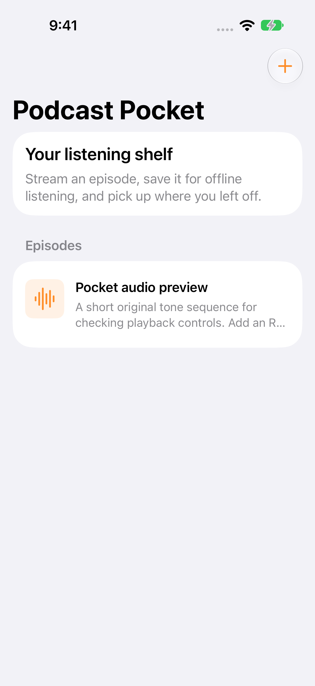

# Podcast Pocket

An RSS podcast reader with offline audio, resume positions, and native playback controls.

[](https://github.com/DawoodAamir/Podcast-Pocket/actions/workflows/ci.yml)

[](LICENSE)



## Features

- Load HTTPS RSS feeds and reject unsafe enclosure schemes.
- Stream or download episodes, retain listening positions, and adjust playback speed.
- Use lock-screen play/pause and skip controls with a spoken-audio session.
- Continue background audio and use system-managed background download tasks.

## Run locally

Open **Podcast Pocket.xcodeproj** and run the shared scheme. The bundled preview is an original 16-second tone sequence for checking playback controls; it is not a published podcast.

Tap **Add RSS feed**, paste an HTTPS podcast RSS URL, and load its episodes. Tap an episode to stream or choose Download, then play it offline. Playback speed ranges from 0.75× to 2×; skip controls go back 15 or forward 30 seconds.

The implementation supports RSS `item`/`enclosure` feeds, not every podcast directory or Atom format. Refresh retains downloaded episodes and their resume positions. It parses titles and summaries as text, without executing feed HTML. Downloads are capped at 500 MB after completion. Background audio and download continuation require physical-device lifecycle testing; local playback and controls are covered by UI tests. Remote feeds and files remain the publisher’s responsibility.

## Structure

- `Sources/Core`: domain logic, also exposed through a Swift Package for tests.
- `Sources/App`: native SwiftUI screens and platform integrations.
- `Tests/Core`: domain regression tests.
- `Tests/UI`: native workflow tests with isolated saved state and retained screenshots.
- `Resources`: assets, app icon, and platform configuration.

## Verification

Requires Xcode 15 or newer for these sources; local checks use the installed Xcode toolchain. No developer team is committed. Simulator builds need no personal signing identity. A physical device requires your own signing and capabilities.

```sh
swift test
swift test -c release
bash Scripts/test-ui.sh
```

CI runs the core tests, a Release build, and native workflow tests. The reference APIs have separate backend checks. See [verification notes](Docs/Verification.md) for the tested environment and remaining device checks.

## Privacy and contribution

Feed URLs and resume positions stay in local storage. Feed and audio requests go directly to the chosen publisher. Downloaded audio is kept in Application Support until removed. No directory account, proxy, or analytics.

See [PRIVACY.md](PRIVACY.md), [CONTRIBUTING.md](CONTRIBUTING.md), and [LICENSE](LICENSE). All example people, assignments, accounts, and order identifiers are fictional. No App Store seller account is connected to this project.
